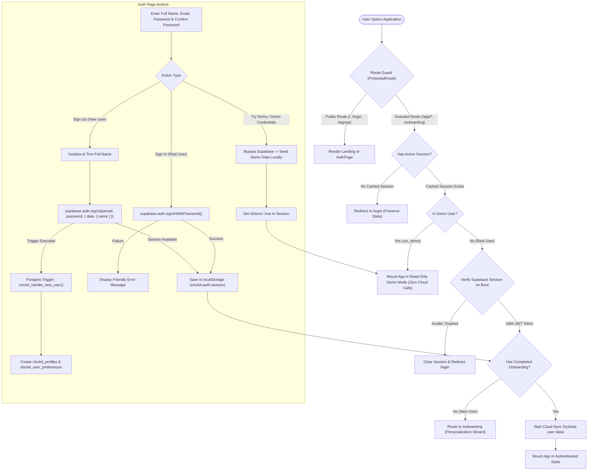

# ClockIt Authentication & Session Architecture

This document describes the end-to-end authentication lifecycle in ClockIt: sign-up, sign-in, session recovery on boot, sign-out, demo authentication, and the database trigger bootstrapping new user records.

---

## 1. Diagram B: Authentication & Signup Flowchart



---

## 2. Authentication Mechanisms

### A. Real Email / Password (Cloud Mode)
- **Engine**: Supabase Auth (GoTrue).
- **Full Name Capture**: Signup strictly requires and collects the user's Full Name (trimmed and sanitized), email, password, and confirm password matching validation.
- **Display Name Normalization**: Handled by `sanitizeDisplayName()`. Under no circumstances is the email prefix (e.g., `user` from `user@example.com`) ever used as a display name fallback. If metadata is absent, defaults strictly to `"ClockIt user"`.
- **Credentials Validation**: Validated over HTTPS using `supabase.auth.signInWithPassword` and `supabase.auth.signUp`.
- **Session Tokens**: JWT access tokens and refresh tokens managed securely by the Supabase client.
- **Session Mirroring**: The resolved user `{ id, name, email }` is cached in `clockit-auth-session` in `localStorage` to allow immediate, synchronous initial paint before network token validation completes.

### B. Isolated Demo Mode
- **Zero Cloud Invocation**: When the visitor enters `demo@clockit.local` or clicks **"Explore Demo Mode"**, `authStore.ts` intercepts the request directly without querying Supabase.
- **Volatile Identity**: Assigns `usr_demo` with `isDemo: true`.
- **Cloud Sync Guard**: `AuthContext.tsx` explicitly evaluates `!user.isDemo` before invoking `startCloudSync(user.id)`.

---

## 3. Database Bootstrap Trigger (`clockit_handle_new_user`)

When a new user successfully registers in `auth.users`, an automated PostgreSQL trigger bootstraps their profile:

```sql
create or replace function public.clockit_handle_new_user()
returns trigger
language plpgsql
security definer
set search_path = ''
as $$
declare
  cleaned_name text;
begin
  -- Extract full name from signup metadata and sanitize
  cleaned_name := nullif(trim(new.raw_user_meta_data ->> 'name'), '');
  if cleaned_name is null then
    cleaned_name := 'ClockIt user';
  end if;

  -- Insert profile for new ClockIt user. If row already exists from earlier,
  -- replace name only if it was empty or was an older email prefix fallback.
  insert into public.clockit_profiles (user_id, name, email)
  values (
    new.id,
    cleaned_name,
    new.email
  )
  on conflict (user_id) do update set
    name = case
      when clockit_profiles.name is null
        or clockit_profiles.name = ''
        or clockit_profiles.name = 'ClockIt user'
        or clockit_profiles.name = split_part(coalesce(new.email, ''), '@', 1)
      then excluded.name
      else clockit_profiles.name
    end,
    email = excluded.email;

  -- Initialize ClockIt user preferences with sensible defaults
  insert into public.clockit_user_preferences (
    user_id,
    theme,
    appearance_preference,
    onboarding_completed,
    preferred_focus_duration
  )
  values (
    new.id,
    'light',
    'system',
    false,
    25
  )
  on conflict (user_id) do nothing;

  return new;
end;
$$;

drop trigger if exists clockit_on_auth_user_created on auth.users;
create trigger clockit_on_auth_user_created
  after insert on auth.users
  for each row execute function public.clockit_handle_new_user();
```

### Safety & Coexistence
- The trigger name `clockit_on_auth_user_created` is unique.
- The trigger function `clockit_handle_new_user()` is uniquely namespaced.
- It never touches the café application's `profiles` table or triggers.
