# ClockIt Database Architecture

This document provides complete schema specifications for all 11 namespaced ClockIt PostgreSQL tables, column definitions, data types, indexes, and Row-Level Security (RLS) policies.

---

## 1. Diagram F: Entity Relationship Diagram (All 11 ClockIt Tables)

```mermaid
erDiagram
  auth_users ||--o{ clockit_profiles : "owns"
  auth_users ||--o{ clockit_workspaces : "owns"
  auth_users ||--o{ clockit_tasks : "owns"
  auth_users ||--o{ clockit_focus_sessions : "owns"
  auth_users ||--o{ clockit_habits : "owns"
  auth_users ||--o{ clockit_calendar_events : "owns"
  auth_users ||--o{ clockit_timeline_events : "owns"
  auth_users ||--o{ clockit_notes : "owns"
  auth_users ||--o{ clockit_note_folders : "owns"
  auth_users ||--o{ clockit_quick_notes : "owns"
  auth_users ||--o{ clockit_user_preferences : "owns"

  clockit_profiles {
    uuid id PK
    uuid user_id FK
    text name
    text email
    timestamptz created_at
    timestamptz updated_at
  }

  clockit_workspaces {
    uuid id PK
    uuid user_id FK
    text client_id
    text name
    text color
    text description
    text icon
    text cover
    timestamptz created_at
    timestamptz updated_at
  }

  clockit_tasks {
    uuid id PK
    uuid user_id FK
    text client_id
    text title
    text description
    text workspace
    text category_color
    text deadline
    date due_date
    text due_time
    text days_left
    text priority
    text status
    boolean completed
    text estimate
    boolean is_today
    boolean is_overdue
    text[] tags
    integer focus_minutes
    integer focus_sessions_count
    timestamptz created_at
    timestamptz updated_at
  }

  clockit_focus_sessions {
    uuid id PK
    uuid user_id FK
    text client_id
    text task_id
    text task_title
    text mode
    integer duration_minutes
    timestamptz completed_at
    timestamptz created_at
    timestamptz updated_at
  }

  clockit_habits {
    uuid id PK
    uuid user_id FK
    text client_id
    text title
    text time
    text duration
    text icon_name
    boolean completed
    integer streak
    timestamptz created_at
    timestamptz updated_at
  }

  clockit_calendar_events {
    uuid id PK
    uuid user_id FK
    text client_id
    integer day
    text title
    text time
    text workspace
    text color
    text tag_color
    timestamptz created_at
    timestamptz updated_at
  }

  clockit_timeline_events {
    uuid id PK
    uuid user_id FK
    text client_id
    text time
    text title
    text subtitle
    text color
    timestamptz created_at
    timestamptz updated_at
  }

  clockit_notes {
    uuid id PK
    uuid user_id FK
    text client_id
    text title
    text folder_id
    text content
    text[] tags
    boolean is_favorite
    boolean is_trash
    boolean is_template
    timestamptz created_at
    timestamptz updated_at
  }

  clockit_note_folders {
    uuid id PK
    uuid user_id FK
    text client_id
    text name
    text color
    text parent_id
    timestamptz created_at
    timestamptz updated_at
  }

  clockit_quick_notes {
    uuid id PK
    uuid user_id FK
    text client_id
    text body
    integer sort_index
    timestamptz created_at
    timestamptz updated_at
  }

  clockit_user_preferences {
    uuid id PK
    uuid user_id FK
    text theme
    boolean sidebar_collapsed
    text[] notification_read_keys
    text active_workspace_id
    timestamptz created_at
    timestamptz updated_at
  }
```



---

## 2. Table Specifications & Indexes

### 1. `clockit_profiles`
- Primary Key: `id uuid default gen_random_uuid()`
- Ownership: `user_id uuid not null unique references auth.users (id) on delete cascade`
- Columns: `name text not null`, `email text not null`, `created_at`, `updated_at`

### 2. `clockit_workspaces`
- Index: `clockit_workspaces_user_idx on clockit_workspaces (user_id)`
- Unique Constraint: `(user_id, client_id)` for idempotent upserts.

### 3. `clockit_tasks`
- Indexes:
  * `clockit_tasks_user_idx on clockit_tasks (user_id)`
  * `clockit_tasks_user_due_idx on clockit_tasks (user_id, due_date)`
- Unique Constraint: `(user_id, client_id)`

### 4. `clockit_focus_sessions`
- Indexes:
  * `clockit_focus_user_idx on clockit_focus_sessions (user_id)`
  * `clockit_focus_user_completed_idx on clockit_focus_sessions (user_id, completed_at desc)`
- Unique Constraint: `(user_id, client_id)`

### 5. `clockit_habits`
- Index: `clockit_habits_user_idx on clockit_habits (user_id)`
- Unique Constraint: `(user_id, client_id)`

### 6. `clockit_calendar_events`
- Index: `clockit_calendar_user_idx on clockit_calendar_events (user_id)`
- Unique Constraint: `(user_id, client_id)`

### 7. `clockit_timeline_events`
- Index: `clockit_timeline_user_idx on clockit_timeline_events (user_id)`
- Unique Constraint: `(user_id, client_id)`

### 8. `clockit_notes`
- Indexes:
  * `clockit_notes_user_idx on clockit_notes (user_id)`
  * `clockit_notes_user_folder_idx on clockit_notes (user_id, folder_id)`
- Unique Constraint: `(user_id, client_id)`

### 9. `clockit_note_folders`
- Index: `clockit_note_folders_user_idx on clockit_note_folders (user_id)`
- Unique Constraint: `(user_id, client_id)`

### 10. `clockit_quick_notes`
- Index: `clockit_quick_notes_user_idx on clockit_quick_notes (user_id, sort_index)`
- Unique Constraint: `(user_id, client_id)`

### 11. `clockit_user_preferences`
- Unique Constraint: `user_id` is unique (1 row per user)
- Base Columns: `theme`, `sidebar_collapsed`, `notification_read_keys`, `active_workspace_id`
- Personalization Columns (Migration 0002):
  * `onboarding_completed` (boolean, default false)
  * `productivity_challenges` (text[], default '{}')
  * `planning_preference` (text)
  * `preferred_focus_duration` (integer, default 25)
  * `appearance_preference` (text, default 'system')

---

## 3. Migration 0002 Review & Manual Execution Procedure

Migration file: `supabase/migrations/0002_user_personalization.sql`

### Verification Summary
- **Scope**: Modifies exclusively `clockit_*` database objects (`clockit_user_preferences`, `clockit_handle_new_user`, `clockit_profiles`).
- **Coexistence**: Zero DDL operations on café tables (`cafes`, `favorites`, `menu_items`, `profiles`, `reviews`). Café auth triggers are untouched.
- **Idempotency**: All statements use `add column if not exists`, `create or replace function`, and `drop trigger if exists ... create trigger`.
- **User Data Safety**: Existing preferences and profiles are fully preserved; profile names are only overwritten on conflict if they were previously empty or email prefix fallbacks.
- **RLS**: Explicitly calls `enable row level security` and `force row level security`.

### Manual Execution Procedure
When ready to apply to a Supabase project:
1. Navigate to the Supabase Dashboard -> **SQL Editor**.
2. Open or paste `supabase/migrations/0002_user_personalization.sql`.
3. Click **Run**.
4. Verify by checking Table Editor -> `clockit_user_preferences` for the 5 new columns.

---

## 4. Row-Level Security (RLS) Policy Definition

Every table has RLS explicitly enabled and forced:

```sql
alter table public.clockit_tasks enable row level security;
alter table public.clockit_tasks force row level security;

create policy "ClockIt users manage their own rows" on public.clockit_tasks
  for all to authenticated
  using (auth.uid() = user_id)
  with check (auth.uid() = user_id);
```

This uniform policy guarantees:
- `SELECT`: Only rows where `auth.uid() = user_id` are returned.
- `INSERT`: Cannot insert rows with another user's ID (`with check`).
- `UPDATE`: Cannot modify rows owned by others or change `user_id`.
- `DELETE`: Cannot delete rows owned by others.
