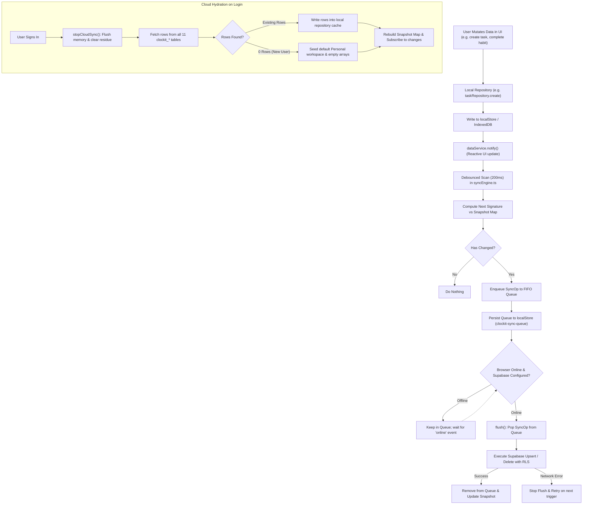

# ClockIt Data Synchronization Architecture

This document describes the local-first synchronization model, repository snapshotting, delta diffing, offline queuing, conflict handling, and cloud re-hydration.

---

## 1. Diagram E: Data Synchronization Flowchart

---

## 2. Sync Engine Mechanics

### A. The Diff Algorithm
1. Every domain registers `readLocal()` and `table`.
2. `syncEngine.ts` maintains an in-memory `snapshots` map storing the JSON representation of local records keyed by table name.
3. When `scan()` executes:
   - It reads current records from the local repository.
   - Compares previous JSON with current JSON.
   - For added or modified items: enqueues `{ kind: 'upsert', table, conflict: 'user_id,client_id', payload }`.
   - For deleted items: enqueues `{ kind: 'delete', table, clientId }`.
   - Updates `snapshots.set(domain.table, signature)`.

### B. Offline Queue Durability
- The queue is written to `localStorage` under `clockit-sync-queue` including the `userId`.
- If the browser closes or loses internet connection, the pending queue is restored on boot when the same user logs in and drained sequentially once online.

### C. Re-hydration on Session Start
When `startCloudSync(userId)` is called:
1. `stopCloudSync()` executes first, purging dirty state from any prior session.
2. For each of the 11 domains, queries `supabase.from(domain.table).select('*').eq('user_id', userId)`.
3. If rows exist: maps them through `domain.fromRow()` and writes them into local storage.
4. If rows do not exist (brand new user): seeds `domain.initialRecords()` (which creates a clean Personal workspace with empty tasks and empty habits), enqueuing the initial workspace to the cloud.
5. Re-reads quick notes and user preferences.
