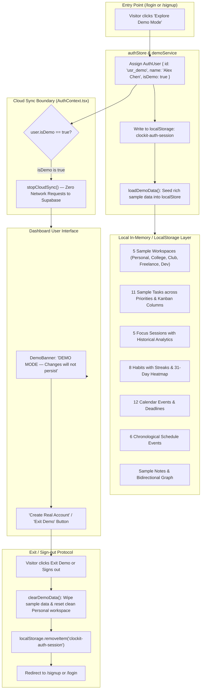

# ClockIt Demo Mode Architecture

This document describes the design, sample data structure, read-only guarantees, banner indicator, and reset behaviors of ClockIt's isolated Demo Mode.

---

## 1. Diagram D: Demo-Mode Architecture Diagram

---

## 2. Technical Guarantees

### A. Zero Cloud Footprint
- Demo mode creates **no accounts in `auth.users`**.
- It writes **no rows to `clockit_*` tables**.
- Every mutating user action is restricted to the browser's local volatile storage and is never dispatched across the network.

### B. Rich Realistic Sample Dataset
Demo mode seeds realistic data for all 11 modules:
- **Workspaces**: Personal, College, Club, Freelance, Development.
- **Tasks**: 11 tasks demonstrating priorities, estimates, due dates, tags, and statuses.
- **Focus**: Sessions showing short breaks, deep work blocks, and productivity graphs.
- **Habits**: Streaks up to 28 days with a realistic 31-day heatmap.
- **Calendar & Timeline**: Rich visual events across morning and afternoon blocks.

### C. Prominent Demo Indicator
- A fixed banner at the top of the main dashboard viewport identifies Demo Mode with a distinctive badge and clear explanatory copy:
  > *"You are exploring ClockIt with sample data. No account required, and no changes are saved to the cloud."*
- Features an immediate **"Create Real Account"** CTA.

### D. Clean Exit Protocol
- Exiting demo mode or signing out triggers `clearDemoData()`, purging all sample data from `localStorage` and IndexedDB.
- Prevents sample tasks from leaking into subsequent real user sessions.
