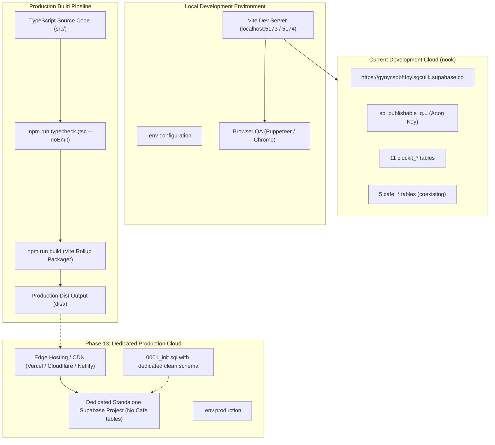

# ClockIt Deployment & Environment Guide

This document describes the current development environment, environment variables, build pipeline, and future production deployment planned for Phase 13.

---

## 1. Diagram I: Deployment Architecture Diagram



---

## 2. Environment Variables

ClockIt uses the following environment variables (defined in `.env` for development):

| Variable | Required | Description | Scope |
| :--- | :---: | :--- | :--- |
| `VITE_SUPABASE_URL` | **Yes** | HTTPS URL of the Supabase API Gateway. | Public / Client |
| `VITE_SUPABASE_ANON_KEY` | **Yes** | Public publishable anon key for PostgREST & Auth. | Public / Client |
| `CLOCKIT_TEST_USER_A_EMAIL` | Optional | Integration test account A email (`streetlight350@gmail.com`). | Test Harness only |
| `CLOCKIT_TEST_USER_A_PASSWORD` | Optional | Integration test account A password. | Test Harness only |
| `CLOCKIT_TEST_USER_B_EMAIL` | Optional | Integration test account B email (`ashay22306@gmail.com`). | Test Harness only |
| `CLOCKIT_TEST_USER_B_PASSWORD` | Optional | Integration test account B password. | Test Harness only |

> [!CAUTION]
> Never include `SUPABASE_SERVICE_ROLE_KEY` in frontend source code or in any `.env` file packaged into the client bundle. The client must only ever use the anonymous publishable key.

---

## 3. Build & Verification Commands

```bash
# Typecheck without emitting code
npm run typecheck

# Build optimized production bundle
npm run build

# Start local preview server
npm run preview

# Run live Supabase integration tests
node scripts/test-live-supabase.mjs
```

---

## 4. Phase 13 Production Transition Plan

In Phase 13, ClockIt will transition from the shared `nook` instance to a dedicated production environment:
1. **Provisioning**: Provision a new, standalone Supabase project with automated daily backups.
2. **Schema Deployment**: Execute `supabase/migrations/0001_init.sql` on the clean production instance.
3. **Custom Domain & SMTP**: Configure custom SMTP credentials (SendGrid/Resend) for production email verification delivery.
4. **Hosting Deployment**: Deploy frontend assets to edge CDN with gzip/brotli compression and caching headers.
