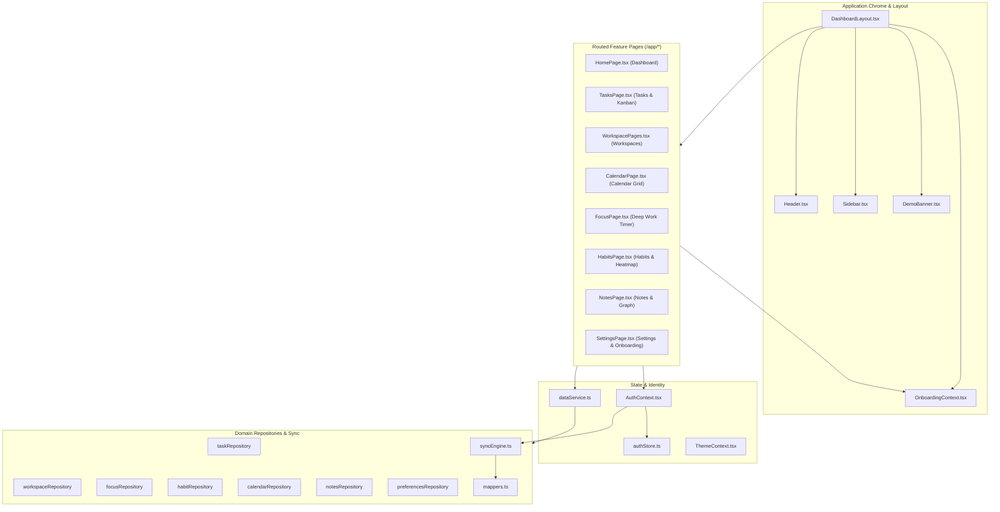

# ClockIt Maintenance, Troubleshooting & Account Inventory Guide

This document details database migrations, common operational issues, debugging workflows, module dependencies, and the formal **Account Inventory & Safe Cleanup Manifest**.

---

## 1. Diagram H: Application Module Relationship Diagram

---

## 2. Account Inventory

An audit of the Supabase instance (`https://gynycspbhfoyisgcuiik.supabase.co`) identified the following accounts:

| User ID | Identifier / Email | Category | Role | Status / Action |
| :--- | :--- | :--- | :--- | :--- |
| `524e4fda-4683-403f-81ea-d1bad4daefa7` | `Ashay Kumar` | **Personal Account** | User / Cafe Admin | **PROTECTED — NEVER TOUCH OR DELETE** |
| `b1dfc026-994d-4d97-826a-cf4722fdf32e` | `Iam Great` | **Cafe App Account** | Legacy Cafe User | **PROTECTED — NEVER TOUCH OR DELETE** |
| `94c6f41f-32cb-42cd-890d-a7dec53cfb03` | `streetlight350@gmail.com` | **ClockIt QA User A** | Integration Testing | **ACTIVE — Preserved for Phase 12/13 QA** |
| `c5df88a3-2bfb-43a6-8403-8cf4d8d9fa34` | `ashay22306@gmail.com` | **ClockIt QA User B** | RLS Isolation Testing | **ACTIVE — Preserved for Phase 12/13 QA** |
| `45506289-7c3e-4513-aa2d-75e3515b5df8` | `ashaykumar2232006+clockit-probe-1794329836042` | **Temporary Signup Probe 1** | Automated test signup | **CANDIDATE FOR CLEANUP (See manifest)** |
| `c777263e-3837-4d83-9c54-ef3226935102` | `ashaykumar2232006+clockit-probe-mwazsw4z` | **Temporary Signup Probe 2** | Automated test signup | **CANDIDATE FOR CLEANUP (See manifest)** |
| `73ed1020-f24c-41b7-9efc-eaca156615cb` | `ashaykumar2232006+clockit-probe-mwb2zb23` | **Temporary Signup Probe 3** | Automated test signup | **CANDIDATE FOR CLEANUP (See manifest)** |
| `d5728707-0ef0-4f59-b316-a05a2b1d6cff` | `ashaykumar2232006+clockit-probe-mwccncvu` | **Temporary Signup Probe 4** | Automated test signup | **CANDIDATE FOR CLEANUP (See manifest)** |
| `usr_demo` (Local) | `demo@clockit.local` | **Local Demo User** | Isolated Demo Mode | **LOCAL ONLY — Never exists in Supabase** |

---

## 3. Safe Account Cleanup Manifest

> [!IMPORTANT]
> In accordance with strict guidelines, **NO accounts are automatically deleted**. Destructive cleanup requires explicit human review and approval.

### Proposed Cleanup Actions (Pending Explicit Approval)
Only temporary probe accounts created by automated signup testing are flagged for cleanup:

1. **Probe Account 1**: `45506289-7c3e-4513-aa2d-75e3515b5df8` (`ashaykumar2232006+clockit-probe-1794329836042@gmail.com`)
2. **Probe Account 2**: `c777263e-3837-4d83-9c54-ef3226935102` (`ashaykumar2232006+clockit-probe-mwazsw4z@gmail.com`)
3. **Probe Account 3**: `73ed1020-f24c-41b7-9efc-eaca156615cb` (`ashaykumar2232006+clockit-probe-mwb2zb23@gmail.com`)
4. **Probe Account 4**: `d5728707-0ef0-4f59-b316-a05a2b1d6cff` (`ashaykumar2232006+clockit-probe-mwccncvu@gmail.com`)

### Protected Accounts (Strict Prohibition)
- **DO NOT TOUCH** `524e4fda-4683-403f-81ea-d1bad4daefa7` (`Ashay Kumar`).
- **DO NOT TOUCH** `b1dfc026-994d-4d97-826a-cf4722fdf32e` (`Iam Great`).
- **DO NOT TOUCH** `94c6f41f-32cb-42cd-890d-a7dec53cfb03` (`streetlight350@gmail.com`).
- **DO NOT TOUCH** `c5df88a3-2bfb-43a6-8403-8cf4d8d9fa34` (`ashay22306@gmail.com`).

---

## 4. Troubleshooting Common Issues

### Issue 1: "Supabase SMTP rate limit reached"
- **Cause**: Supabase free-tier project rate-limits confirmation emails to 3-4 per hour.
- **Resolution**: Use pre-confirmed accounts (`CLOCKIT_TEST_USER_A_EMAIL`, `CLOCKIT_TEST_USER_B_EMAIL`) or configure custom SMTP in Phase 13.

### Issue 2: Cross-user local storage contamination
- **Resolution**: Implemented in Phase 12.3: `stopCloudSync()` purges local cache on logout and re-seeds clean initial defaults.

### Issue 3: Demo changes showing in a real account
- **Resolution**: Implemented in Phase 12.4: Demo mode runs with `isDemo: true`, completely bypassing `startCloudSync()` and calling `clearDemoData()` on logout.
