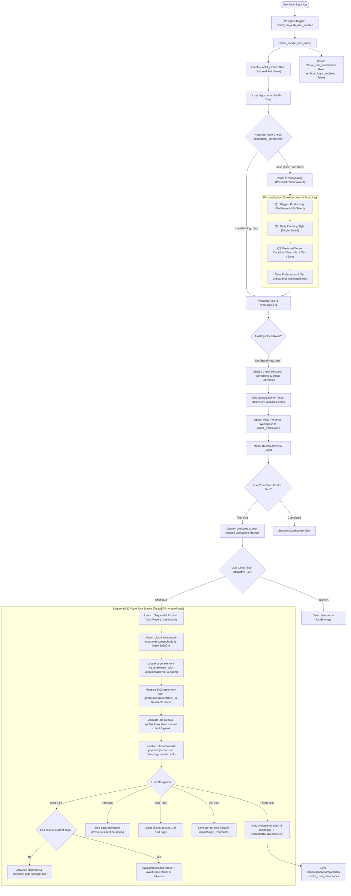

# ClockIt Onboarding, Personalization & Multi-Page Tour Architecture

This document describes the personalized first-time setup wizard, the sequential 11-page interactive product tour, portal rendering architecture, spotlight geometry handling, and progress persistence.

---

## 1. Diagram C: New-User Initialization & Onboarding Flowchart



---

## 2. Personalization Questionnaire (`/onboarding`)

After successful account creation and verification, first-time users are routed to `/onboarding`:

1. **Productivity Challenges (Multi-select)**:
   - Staying focused
   - Managing too many tasks
   - Maintaining consistency
   - Organizing information
   - Managing time
   - Keeping everything organized
2. **Planning Preference (Single-select)**:
   - Morning review
   - Night before
   - Flexible / As needed
   - Time blocking
3. **Preferred Deep Work Duration (Single-select presets / slider)**:
   - 25 minutes (Pomodoro Classic)
   - 45 minutes (Deep Dive)
   - 60 minutes (Power Hour)
   - 90 minutes (Ultra Cycle)
   - Directly configures the default deep work timer duration throughout ClockIt.
4. **Skip & Edit**:
   - Users can choose **"Skip Setup"** at any step; sensible defaults are applied immediately.
   - Users can retake or adjust the personalization questionnaire anytime from **Settings** (`/app/settings`).

---

## 3. The 11-Page Sequential Product Tour

The tour spans 11 real application pages, comprising 48 focused steps:

| Page | Route | Steps | Key Features Highlighted |
|---|---|:---:|---|
| **1. Dashboard** | `/app` | 6 | Welcome overview, KPI snapshot, Quick focus launcher, Task summary, Mini calendar, Today's timeline |
| **2. Tasks** | `/app/tasks` | 6 | Task management engine, Create task modal, Filter tabs (All/Today/Upcoming/Overdue), Quick-add & sort, Task row actions, Calendar side widget |
| **3. Workspaces** | `/app/workspaces` | 4 | Context separation, Create custom space dialog, Grid/Compact layout switch, Workspace cards |
| **4. Calendar** | `/app/calendar` | 4 | Month/Week/Day view navigation, Schedule new event, Color-coded month grid, Today's agenda feed |
| **5. Focus Timer** | `/app/focus` | 5 | SVG countdown dial, Mode switching (Deep Work / Short Break / Long Break), Start/Pause controls, Task-linking picker, Timer settings & Zen mode |
| **6. Habits** | `/app/habits` | 5 | Consistency KPIs, Create habit routine, Daily checklist row, Streak counter & flame, 31-day visual ring heatmap |
| **7. Notes** | `/app/notes` | 4 | Knowledge base sidebar, Hierarchical folders, Tagging & quick filters, Note editor & `[[Wiki-links]]` |
| **8. Quick Notes** | `/app` | 3 | Dashboard scratchpad, Instant capture & autosave, Expanded full modal canvas |
| **9. Timeline** | `/app` | 2 | Daily chronological schedule, Integrated time blocks & activity logs |
| **10. Analytics** | `/app/analytics` | 4 | Cockpit overview, 7d/14d/30d timeframe filter, Deep work & completion KPIs, Focus distribution charts |
| **11. Settings** | `/app/settings` | 5 | Account identity & profile name, Theme toggle (Light/Dark/System), Personalization profile, Tour replay directory, Final tour completion |

---

## 4. Stacking Order & Portal Architecture

To guarantee the tutorial remains consistently above all application components (including fixed headers, sidebar drawers, modal backdrops, and GSAP page transitions), the tour overlay is rendered through a React Portal directly into `document.body`:

```
document.body
└── .clockit-tour-portal-root                 [z-index: 99990]
    ├── .clockit-tour-backdrop-catcher        [z-index: 99991] (dismiss on outside click)
    ├── .clockit-tour-spotlight-box           [z-index: 99992] (smooth box-shadow cutout)
    └── .clockit-tutorial-popover             [z-index: 99995] (responsive card with controls)
```

### Spotlight Cutout Geometry
- Instead of mutating the target DOM element's classes, the portal renders `.clockit-tour-spotlight-box`.
- The box shadow (`0 0 0 9999px rgba(15, 17, 21, 0.58)`) dims the surrounding viewport while leaving a transparent window over the target.
- Geometry (`top`, `left`, `width`, `height`) smoothly glides between elements using CSS transitions (`cubic-bezier(0.16, 1, 0.3, 1)`).
- `ResizeObserver` and passive scroll/resize listeners ensure the spotlight tracks dynamic layouts and scrolling.
- On screens $\le 640\text{px}$, the popover card docks to the bottom edge (`bottom: 16px, left: 16px, right: 16px`).
- Reduced motion preference (`@media (prefers-reduced-motion: reduce)`) is strictly respected.
