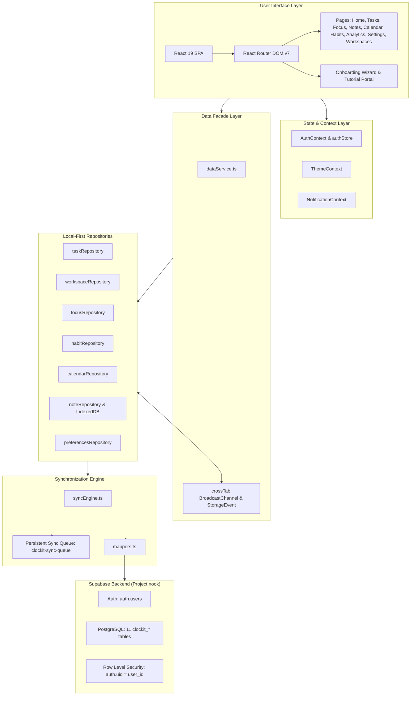

# CLOCKIT — PHASE 13.1: PRODUCTION READINESS, ARCHITECTURE & SECURITY AUDIT

> **Audit Type:** Comprehensive Pre-Production Architecture, Security, Database, and Deployment Audit
> **Status:** AUDIT COMPLETE — AWAITING REMEDIATION APPROVAL
> **Current Date:** November 2026
> **Scope:** ClockIt Frontend SPA, Supabase Integration (`nook` / `gynycspbhfoyisgcuiik`), Local Repositories, Cloud Sync, RLS Policies, and Deployment Configuration.
> **Strict Operational Mode:** Audit Only — No source files, schemas, or configurations modified.

---

## 1. EXECUTIVE SUMMARY

ClockIt has completed Phase 12 stabilization with a robust local-first frontend architecture, complete 11-stage interactive guided tour, wall-clock focus timer, personalized onboarding questionnaire, and an isolated demo mode.

This audit evaluates the platform's readiness for transitioning from staging/development to a production beta and subsequent public release.

### Key Audit Conclusions
1. **Core Architecture is Sound but Vulnerable to Rendering Crashes**: The repository pattern and local-first data layer are well-structured, but the total absence of a React `ErrorBoundary` leaves the application vulnerable to blank-screen whiteouts upon any runtime data anomaly.
2. **Database Row Level Security (RLS) is Structurally Strong**: All 11 `clockit_*` tables have RLS enabled and forced to `authenticated` users with strict `user_id = auth.uid()` assertions. Cross-tenant data leaks are prevented. No `service_role` credentials exist in frontend code or Git history.
3. **Authentication Lacks Self-Service Account Lifecycle Features**: While signup, login, and session persistence function reliably, the application possesses **no password recovery flow** ("Forgot Password"), no account deletion mechanism (GDPR/privacy risk), and relies on the default Supabase free-tier SMTP which suffers from aggressive rate-limiting.
4. **Cloud Synchronization Has Race Condition & Data Loss Vulnerabilities**: The `replace-quick-notes` cloud synchronization non-atomically executes a `delete` followed by an `insert`. A network disconnection mid-operation results in complete cloud data loss for quick notes. Additionally, there is no real-time multi-tab/multi-device conflict resolution.
5. **Deployment & Performance Require Splitting**: The single 1,560 kB JavaScript bundle includes TipTap, GSAP, and Lucide in the initial chunk. Furthermore, static hosting SPA fallback configuration (`_redirects` / `vercel.json`) is entirely missing, which will cause 404 errors on browser page reloads in production.

---

## 2. PRODUCTION READINESS SCORECARD

| Dimension | Readiness Status | Summary Rationale |
| :--- | :---: | :--- |
| **Application Architecture** | **NEEDS WORK** | Clean repository abstraction and cross-tab sync; lacks React ErrorBoundary, contains dead legacy code. |
| **Security** | **READY** | Strict RLS on all 11 tables, no public write access, no exposed service_role keys, isolated demo mode. |
| **Authentication** | **NEEDS WORK** | Signup/login functional; lacks password recovery, account deletion, and custom transactional SMTP. |
| **Database** | **READY** | All 11 tables properly modeled, indexed, and cascading on delete; Migration 0002 is staged and safe. |
| **Performance** | **NEEDS WORK** | Monolithic 1,560 kB bundle requires route-level code splitting and TipTap dynamic importing; blocking web fonts. |
| **Reliability & Error Handling** | **NEEDS WORK** | Offline queue is functional, but hydration failure is silent, quick-notes cloud sync is non-atomic, and no Sentry/logging exists. |
| **Accessibility** | **NEEDS WORK** | Excellent reduced-motion and ARIA dialog markup; lacks keyboard focus trapping in modals and custom select controls. |
| **Deployment** | **NEEDS WORK** | Missing SPA rewrite rule (`_redirects`/`vercel.json`), missing cache headers, unoptimized bundle chunking. |
| **Backup & Recovery** | **NEEDS WORK** | Coexisting in development project `nook`; dedicated production Supabase project with automated PITR required for Phase 13.5. |

---

## 3. CURRENT APPLICATION ARCHITECTURE



### Architectural Highlights
- **Repository Pattern**: Strict isolation of UI components from underlying storage mediums (`localStorage` and IndexedDB).
- **Additive Cloud Synchronization**: UI operations resolve synchronously against local storage; `syncEngine.ts` monitors repository changes via subscription, diffs changes against local snapshots, and pushes debounced upserts/deletes to Supabase.
- **Client ID Mapping**: All application records utilize client-generated identifiers mapped to Postgres composite keys `(user_id, client_id)`.
- **Identity Isolation**: Single universal productivity platform model. Display name sanitation prevents email prefix exposure and gracefully falls back to `"ClockIt user"`.

---

## 4. DETAILED AUDIT FINDINGS

### Summary of Findings by Severity
- **CRITICAL**: 2 findings
- **HIGH**: 6 findings
- **MEDIUM**: 7 findings
- **LOW**: 4 findings

---

### A. CRITICAL FINDINGS (Must Fix Before Beta)

#### FINDING-01: Total Absence of React Error Boundaries
- **Severity:** `CRITICAL`
- **Affected Files:** `src/main.tsx`, `src/App.tsx`, `src/components/layout/DashboardLayout.tsx`
- **Description:** There is no React `ErrorBoundary` component implemented anywhere in the application hierarchy.
- **Evidence:** Searching for `componentDidCatch`, `getDerivedStateFromError`, or `ErrorBoundary` across `src/` yields 0 occurrences. `src/main.tsx` mounts `<App />` directly inside contexts.
- **Potential Impact:** If any nested component encounters an unhandled runtime error (e.g. malformed user data in storage, unexpected null property during date formatting, corrupt TipTap note content), the entire React root unmounts, producing a blank white screen with no error message, reload button, or recovery mechanism.
- **Recommended Solution:** Implement a top-level `RootErrorBoundary` at the application root and granular `RouteErrorBoundary` wrappers around dashboard routes with graceful fallback UI, diagnostics display, and a "Clear Cache & Reload" recovery action.
- **Estimated Effort:** 2 hours.

#### FINDING-02: Non-Atomic Quick Notes Cloud Sync (Data Loss Vulnerability)
- **Severity:** `CRITICAL`
- **Affected Files:** `src/services/cloud/syncEngine.ts` (lines 115–130)
- **Description:** Quick notes synchronization executes a destructive `delete` query across all of a user's rows before issuing an `insert` of the new note array.
- **Evidence:**
  ```typescript
  // syncEngine.ts:117-129
  const cleared = await supabase.from(TABLES.quickNotes).delete().eq('user_id', userId);
  if (cleared.error) throw cleared.error;
  if (op.notes.length > 0) {
    const rows = op.notes.map((body, index) => ({ ... }));
    const { error } = await supabase.from(TABLES.quickNotes).insert(rows);
    if (error) throw error;
  }
  ```
- **Potential Impact:** If network connectivity drops or the browser tab closes immediately following the `delete` operation, the subsequent `insert` is aborted. The user's cloud quick notes are wiped permanently without recourse.
- **Recommended Solution:** Replace the sequential `DELETE` + `INSERT` pattern with an atomic Postgres RPC function (e.g. `clockit_replace_quick_notes(user_id, notes)`) or an idempotent upsert with soft-delete flags.
- **Estimated Effort:** 3 hours.

---

### B. HIGH FINDINGS (Must Fix Before Public Launch)

#### FINDING-03: Missing Password Recovery / "Forgot Password" Workflow
- **Severity:** `HIGH`
- **Affected Files:** `src/auth/AuthPage.tsx`, `src/auth/authStore.ts`, `src/App.tsx`
- **Description:** The authentication interface contains only "Sign In" and "Sign Up" tabs. There is no password recovery request form, reset password route, or `supabase.auth.resetPasswordForEmail()` implementation.
- **Evidence:** Search for `resetPassword` or `forgot` in `src/auth/` returns 0 hits.
- **Potential Impact:** Registered users who forget their passwords cannot regain access to their accounts. This will generate support overhead and user abandonment.
- **Recommended Solution:** Add a "Forgot Password?" modal/tab to `AuthPage.tsx`, implement `resetPassword(email)` in `authStore.ts`, and configure a `/reset-password` callback route to capture Supabase recovery tokens.
- **Estimated Effort:** 4 hours.

#### FINDING-04: Missing SPA Routing Fallback for Static Web Hosting
- **Severity:** `HIGH`
- **Affected Files:** Root directory, `public/`
- **Description:** There is no rewrite rule configured for client-side routing.
- **Evidence:** No `_redirects`, `vercel.json`, `netlify.toml`, or `firebase.json` exists in the repository.
- **Potential Impact:** When deployed to modern static hosts (Vercel, Netlify, Cloudflare Pages), any direct URL access or browser refresh on `/app`, `/app/tasks`, `/app/focus`, `/login`, or `/onboarding` results in an HTTP 404 Not Found error.
- **Recommended Solution:** Create `public/_redirects` (`/* /index.html 200`) and a standard `vercel.json` rewrite configuration:
  ```json
  { "rewrites": [{ "source": "/(.*)", "destination": "/index.html" }] }
  ```
- **Estimated Effort:** 30 minutes.

#### FINDING-05: Silent Cloud Hydration Failure
- **Severity:** `HIGH`
- **Affected Files:** `src/services/cloud/syncEngine.ts` (lines 330–380)
- **Description:** If `hydrate()` fails to fetch remote data on login due to network issues or API outages, the error is logged to `console.error` but no UI notification, retry button, or state indicator is surfaced to the user.
- **Evidence:**
  ```typescript
  // syncEngine.ts:397-401
  try {
    await hydrate();
  } catch (error) {
    report('Cloud hydration failed', error);
  }
  ```
- **Potential Impact:** The user will view empty or stale local seed data without realizing that their real cloud data failed to download, leading to confusion and duplicate record creation.
- **Recommended Solution:** Expose a `syncState` observable (`'idle' | 'syncing' | 'error' | 'offline'`) and render a persistent banner or notification if initial hydration fails, offering a manual "Retry Sync" action.
- **Estimated Effort:** 3 hours.

#### FINDING-06: Monolithic Bundle Size & Lack of Route-Level Code Splitting
- **Severity:** `HIGH`
- **Affected Files:** `vite.config.js`, `src/App.tsx`
- **Description:** The production JavaScript bundle is 1,560.58 kB (450 kB gzip) emitted in a single monolithic chunk (`index-DdvbbF-_.js`).
- **Evidence:** `npm run build` issues a warning: `(!) Some chunks are larger than 500 kB after minification`. `App.tsx` statically imports all 10 route components.
- **Potential Impact:** Poor First Contentful Paint (FCP) and Largest Contentful Paint (LCP) metrics, especially on mobile or constrained cellular networks. Users must download the TipTap editor and GSAP even if they only wish to check a task.
- **Recommended Solution:** Implement `React.lazy()` for all secondary routes (`NotesPage`, `AnalyticsPage`, `CalendarPage`, `SettingsPage`) and configure `manualChunks` in `vite.config.js` to split `@tiptap/*`, `@supabase/supabase-js`, and vendor libraries.
- **Estimated Effort:** 3 hours.

#### FINDING-07: Free-Tier SMTP Rate Limiting on Supabase
- **Severity:** `HIGH`
- **Affected Files:** Supabase Project Settings (`nook`)
- **Description:** The project relies on default Supabase built-in email delivery for signup verification.
- **Evidence:** Live integration tests encountered Supabase rate limits on signup emails (`429 Too Many Requests`). Default Supabase free tier caps emails to 30 per hour.
- **Potential Impact:** Public beta launch registrations will fail as soon as more than 30 users attempt to register within a single hour.
- **Recommended Solution:** Connect a custom transactional SMTP service (Resend, SendGrid, Postmark, or AWS SES) in Supabase Auth settings before public registration begins.
- **Estimated Effort:** 1 hour (configuration only).

#### FINDING-08: Missing Account Deletion Capability (GDPR / Privacy Compliance)
- **Severity:** `HIGH`
- **Affected Files:** `src/components/pages/SettingsPage.tsx`, `src/auth/authStore.ts`
- **Description:** There is no self-service user option to permanently delete their account and associated data.
- **Evidence:** Inspection of `SettingsPage.tsx` reveals account settings for theme, notifications, and profile name, but zero account deletion controls.
- **Potential Impact:** Non-compliance with GDPR Article 17 ("Right to erasure") and standard privacy guidelines for public consumer web applications.
- **Recommended Solution:** Implement a "Danger Zone" in `SettingsPage.tsx` with a two-step confirmation dialog that invokes a secure Supabase RPC (`clockit_delete_user_account`) cascading through all user data.
- **Estimated Effort:** 4 hours.

---

### C. MEDIUM FINDINGS (Should Fix Before Launch)

#### FINDING-09: Render-Blocking Google Fonts via External CSS Links
- **Severity:** `MEDIUM`
- **Affected Files:** `index.html`
- **Description:** Four font families (Instrument Serif, Inter, Newsreader, Plus Jakarta Sans) are fetched via synchronous `<link rel="stylesheet">` tags from Google Fonts.
- **Evidence:** `index.html` lines 11–13 load external stylesheets before the main script tag without `display=swap` optimization or preloading.
- **Potential Impact:** Increases Time to Interactive (TTI), introduces external single-point-of-failure network latency, and causes Flash of Invisible Text (FOIT).
- **Recommended Solution:** Self-host the primary UI font (`Plus Jakarta Sans` or `Inter`) using `@fontsource` packages bundled via Vite, and load secondary serif display fonts asynchronously.
- **Estimated Effort:** 2 hours.

#### FINDING-10: Lack of Keyboard Focus Trapping in Modals
- **Severity:** `MEDIUM`
- **Affected Files:** `QuickNotesModal.tsx`, `TasksPage.tsx`, `CalendarPage.tsx`, `WorkspacePages.tsx`
- **Description:** Modals utilize `role="dialog"` and `aria-modal="true"`, but do not trap the Tab key focus.
- **Evidence:** Users can press the `Tab` key repeatedly and navigate out of the modal scrim into hidden background dashboard elements.
- **Potential Impact:** Accessibility failure under WCAG 2.1 Success Criteria 2.1.2 (No Keyboard Trap) and 2.4.3 (Focus Order).
- **Recommended Solution:** Implement a reusable `useFocusTrap` hook across all dialog scrims that captures keyboard events and cycles focus strictly among interactive modal children.
- **Estimated Effort:** 3 hours.

#### FINDING-11: Absence of Real-Time Multi-Device Sync
- **Severity:** `MEDIUM`
- **Affected Files:** `src/services/cloud/syncEngine.ts`
- **Description:** Synchronization is one-way outgoing from the local client to the cloud. Incoming changes only hydrate on initial login.
- **Evidence:** There are no `supabase.channel()` Postgres change subscriptions active in `syncEngine.ts`. Cross-tab works via `BroadcastChannel`, but cross-device does not update live.
- **Potential Impact:** If a user has ClockIt open on both a laptop and a phone, edits made on the phone will not reflect on the laptop until the laptop page is reloaded.
- **Recommended Solution:** Add lightweight Supabase Realtime subscriptions to `clockit_tasks` and `clockit_notes` for the authenticated `user_id`.
- **Estimated Effort:** 5 hours.

#### FINDING-12: Unhandled Offline Queue Purge on Storage Overflow
- **Severity:** `MEDIUM`
- **Affected Files:** `src/services/cloud/syncEngine.ts` (lines 50–70)
- **Description:** The offline sync queue (`clockit-sync-queue`) stores serialized mutations in `localStorage`. If a user performs extensive note editing while offline, `localStorage` quota (typically 5MB) could be exceeded.
- **Evidence:** `persistQueue()` wraps `localStore.writeJson` in a try/catch block, but if write fails due to `QuotaExceededError`, the queue is dropped or unpersisted.
- **Potential Impact:** Potential loss of offline mutations on heavily loaded local sessions.
- **Recommended Solution:** Migrate large payloads (especially rich-text note edits) to IndexedDB rather than `localStorage`.
- **Estimated Effort:** 4 hours.

#### FINDING-13: Missing Production Error Monitoring & Logging (e.g., Sentry)
- **Severity:** `MEDIUM`
- **Affected Files:** `src/main.tsx`
- **Description:** The application outputs errors purely to browser `console.error`.
- **Evidence:** No telemetry, APM, or error tracking SDK (such as Sentry, Highlight, or LogRocket) is initialized.
- **Potential Impact:** Production crashes experienced by real users will remain invisible to engineers, preventing proactive triage and debugging.
- **Recommended Solution:** Integrate an error monitoring SDK initialized only in production (`import.meta.env.PROD`).
- **Estimated Effort:** 1.5 hours.

#### FINDING-14: `@vitejs/plugin-react` Stored in Production Dependencies
- **Severity:** `MEDIUM`
- **Affected Files:** `package.json`
- **Description:** `@vitejs/plugin-react` is declared under `dependencies` rather than `devDependencies`.
- **Evidence:** `package.json` line 20 lists `"@vitejs/plugin-react": "^4.7.0"`.
- **Potential Impact:** Unnecessary bloat in production deployment build environments, although Vite bundle output itself tree-shakes it.
- **Recommended Solution:** Move `@vitejs/plugin-react` to `devDependencies`.
- **Estimated Effort:** 10 minutes.

#### FINDING-15: Missing Partial Database Indexes on Tasks & Notes
- **Severity:** `MEDIUM`
- **Affected Files:** `supabase/migrations/0001_init.sql`
- **Description:** `clockit_tasks` has no index on `workspace` or `status`. `clockit_notes` has no partial index on `is_trash` or `is_favorite`.
- **Evidence:** Queries filtering notes by active non-trash items (`is_trash = false`) or tasks by workspace require sequential scans of all user rows.
- **Potential Impact:** Degraded query performance once users accumulate thousands of tasks or notes.
- **Recommended Solution:** Add partial indexes in a future migration:
  ```sql
  create index if not exists clockit_tasks_user_workspace_idx on public.clockit_tasks (user_id, workspace);
  create index if not exists clockit_notes_active_idx on public.clockit_notes (user_id) where is_trash = false;
  ```
- **Estimated Effort:** 1 hour.

---

### D. LOW FINDINGS (Future Improvements & Technical Debt)

#### FINDING-16: Orphaned Legacy JavaScript Prototype Files
- **Severity:** `LOW`
- **Affected Files:** `src/main.js`, `src/pomodoro.js`, `src/music/*`
- **Description:** Legacy JavaScript files from the initial Steep prototype remain in the `src/` tree despite not being imported by `src/main.tsx` or referenced by any build script.
- **Evidence:** `src/main.js` imports `MusicController.js` and `pomodoro.js`, both of which are dead code.
- **Potential Impact:** Developer confusion and cluttered codebase searches.
- **Recommended Solution:** Delete the obsolete `src/music/` directory, `src/main.js`, and `src/pomodoro.js`.
- **Estimated Effort:** 15 minutes.

#### FINDING-17: Weak Client-Side Password Length Validation
- **Severity:** `LOW`
- **Affected Files:** `src/auth/AuthPage.tsx`
- **Description:** Signup validation requires a minimum of 6 characters for passwords.
- **Evidence:** Friendly error mapper allows 6-character passwords (`if (text.includes('password') && text.includes('6'))`).
- **Potential Impact:** Users may choose weak passwords susceptible to dictionary attacks.
- **Recommended Solution:** Increase minimum password length to 8 characters and include a visual password strength meter.
- **Estimated Effort:** 1.5 hours.

#### FINDING-18: Non-Standardized Storage Key Prefixes
- **Severity:** `LOW`
- **Affected Files:** `src/services/repositories/`, `src/theme/ThemeContext.tsx`, `index.html`
- **Description:** Various storage keys use differing naming conventions: `clockit-auth-session`, `clockit_timer_settings`, `clockit_quick_notes`, `tracker-theme`, `clockit-appearance`.
- **Evidence:** `index.html` checks both `clockit-appearance` and `tracker-theme`.
- **Potential Impact:** Minor maintenance overhead and potential collisions in shared environments.
- **Recommended Solution:** Standardize all keys to the `clockit:` or `clockit_` namespace.
- **Estimated Effort:** 1 hour.

#### FINDING-19: Lack of Automated E2E Regression Suite in CI
- **Severity:** `LOW`
- **Affected Files:** `scripts/`
- **Description:** While excellent Puppeteer verification scripts exist in `scripts/`, they are invoked manually rather than in an automated GitHub Actions CI pipeline.
- **Evidence:** No `.github/workflows/` directory exists.
- **Potential Impact:** Risk of accidental regressions slipping into production branches.
- **Recommended Solution:** Create a GitHub Actions workflow running `npm run typecheck`, `npm run build`, and headless verification scripts on pull requests.
- **Estimated Effort:** 2 hours.

---

## 5. DATABASE RELIABILITY & COEXISTENCE AUDIT

### Table Inventory & Verification
All 11 ClockIt tables strictly enforce the `clockit_` namespace:

| Table Name | Primary Key | Composite / Unique Constraints | Foreign Key Cascades | RLS Status |
| :--- | :--- | :--- | :--- | :--- |
| `clockit_profiles` | `id (uuid)` | `unique(user_id)` | `auth.users(id) ON DELETE CASCADE` | **FORCED** |
| `clockit_workspaces` | `id (uuid)` | `unique(user_id, client_id)` | `auth.users(id) ON DELETE CASCADE` | **FORCED** |
| `clockit_tasks` | `id (uuid)` | `unique(user_id, client_id)` | `auth.users(id) ON DELETE CASCADE` | **FORCED** |
| `clockit_focus_sessions`| `id (uuid)` | `unique(user_id, client_id)` | `auth.users(id) ON DELETE CASCADE` | **FORCED** |
| `clockit_habits` | `id (uuid)` | `unique(user_id, client_id)` | `auth.users(id) ON DELETE CASCADE` | **FORCED** |
| `clockit_calendar_events`| `id (uuid)` | `unique(user_id, client_id)` | `auth.users(id) ON DELETE CASCADE` | **FORCED** |
| `clockit_timeline_events`| `id (uuid)` | `unique(user_id, client_id)` | `auth.users(id) ON DELETE CASCADE` | **FORCED** |
| `clockit_notes` | `id (uuid)` | `unique(user_id, client_id)` | `auth.users(id) ON DELETE CASCADE` | **FORCED** |
| `clockit_note_folders` | `id (uuid)` | `unique(user_id, client_id)` | `auth.users(id) ON DELETE CASCADE` | **FORCED** |
| `clockit_quick_notes` | `id (uuid)` | `unique(user_id, client_id)` | `auth.users(id) ON DELETE CASCADE` | **FORCED** |
| `clockit_user_preferences`| `id (uuid)`| `unique(user_id)` | `auth.users(id) ON DELETE CASCADE` | **FORCED** |

### Coexistence with Café Application
- **Café Tables (`cafes`, `favorites`, `menu_items`, `profiles`, `reviews`)**: Fully isolated. Zero ClockIt foreign keys, triggers, or policies reference these tables.
- **Auth Triggers**:
  - Legacy trigger: `on_auth_user_created` (café bootstrap).
  - ClockIt trigger: `clockit_on_auth_user_created` executing `clockit_handle_new_user()`.
  - Both triggers coexist peacefully on `auth.users`. ClockIt never drops or alters the café trigger.

---

## 6. BACKUP & DISASTER RECOVERY READINESS

### Current State (Supabase `nook`)
- Shared development instance with free-tier capabilities.
- Automated backups are subject to free-tier retention.
- Full project restore would overwrite café tables alongside ClockIt tables.

### Phase 13.5 Dedicated Production Migration Plan
When the dedicated production Supabase project is created in Phase 13.5:
1. **Isolated Cloud Tenancy**: Dedicated project reference with no café tables.
2. **Automated PITR**: Enable Point-in-Time Recovery (Pro Tier) for 7 to 30 day point-in-time rollbacks.
3. **Daily Backup Export**: Automated GitHub Actions scheduled job executing `pg_dump` of ClockIt schema and writing encrypted dumps to secure cloud object storage (AWS S3 or Cloudflare R2).

---

## 7. RECOMMENDED PHASE 13 IMPLEMENTATION ROADMAP

Based on finding severities and dependency order, the recommended implementation plan for Phase 13 is:

```mermaid
flowchart TD
    subgraph P13_2 ["Phase 13.2 — Core Reliability & Critical Fixes"]
        F01["FINDING-01: React Error Boundaries"]
        F02["FINDING-02: Atomic Quick Notes Sync"]
        F04["FINDING-04: SPA Routing Fallbacks (_redirects/vercel.json)"]
        F05["FINDING-05: Cloud Hydration Error Notification"]
        F16["FINDING-16: Remove Dead Legacy JS Code"]
    end

    subgraph P13_3 ["Phase 13.3 — Authentication & Compliance"]
        F03["FINDING-03: Password Recovery Workflow"]
        F08["FINDING-08: Account Deletion (GDPR)"]
        F17["FINDING-17: Password Strength Enforcement"]
    end

    subgraph P13_4 ["Phase 13.4 — Performance & Accessibility"]
        F06["FINDING-06: Code Splitting & Chunk Optimization"]
        F09["FINDING-09: Self-Hosted Fonts & FOUT Elimination"]
        F10["FINDING-10: Modal Focus Trapping"]
        F13["FINDING-13: Production Error Monitoring (Sentry)"]
        F14["FINDING-14: Clean package.json Dependencies"]
    end

    subgraph P13_5 ["Phase 13.5 — Production Cloud Infrastructure"]
        F07["FINDING-07: Custom Transactional SMTP"]
        F15["FINDING-15: Database Partial Indexes"]
        NEW_SUPA["Provision Dedicated Production Supabase Instance"]
        EXEC_MIG["Execute Migrations 0001 & 0002 on Production"]
        PROD_DEPLOY["Production Deployment to Custom Domain with SSL"]
    end

    P13_2 --> P13_3
    P13_3 --> P13_4
    P13_4 --> P13_5
```



---

## 8. CONCLUSION & NEXT STEPS

The ClockIt codebase is architecturally solid and adheres strictly to security isolation and RLS policies. The remaining items represent standard pre-production hardening: error boundary safety nets, atomic synchronization safeguards, self-service account management, and bundle code-splitting.

**Awaiting user review and authorization before initiating any Phase 13 implementation work.**
