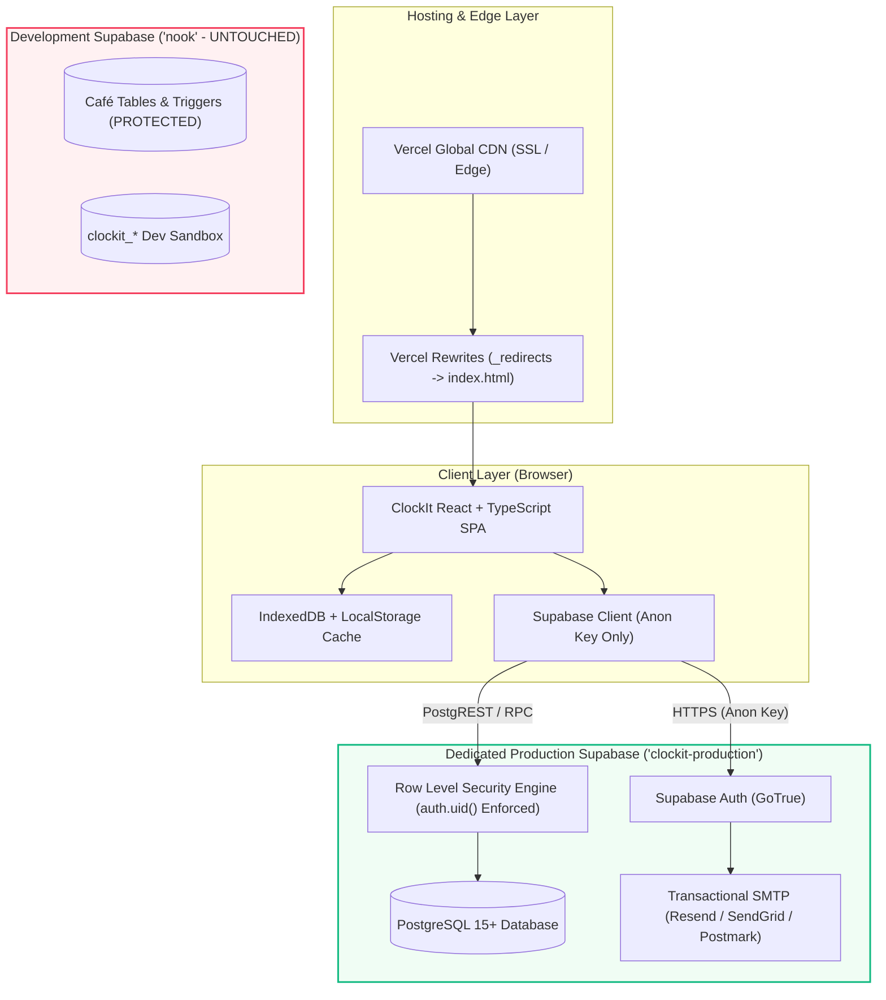
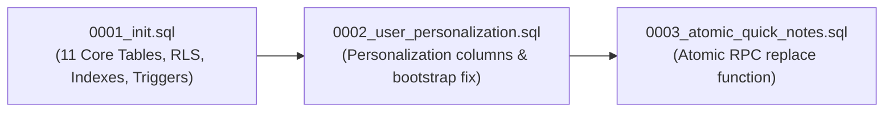

# ClockIt — Phase 13.5: Production Infrastructure Specification & Architecture Plan

**Project Status:** Feature Freeze — Production Infrastructure Stage\
**Target Environment:** Dedicated Supabase Production Project (`clockit-production`)\
**Existing Environment:** Shared Development Project (`nook` — `gynycspbhfoyisgcuiik`)\
**Date:** November 12, 2026\

---

## 1. Production Architecture Overview

ClockIt is transitioning from a shared development instance (`nook`, shared with an older café application) to a completely isolated, single-tenant production infrastructure.

### Architectural Boundary Model



---

## 2. Development vs. Production Environment Matrix

| Dimension | Development Environment (`nook`) | Production Environment (`clockit-production`) |
| :--- | :--- | :--- |
| **Project Reference** | `gynycspbhfoyisgcuiik` | *Pending creation in Phase 13.5* |
| **Project URL** | `https://gynycspbhfoyisgcuiik.supabase.co` | `https://<prod-ref>.supabase.co` |
| **Coexistence Scope** | Shared with legacy café app (`cafes`, `menu_items`, `profiles`, `reviews`) | **100% Dedicated to ClockIt (Zero legacy dependencies)** |
| **Account Deletion** | **Permanently disabled** in UI (`Disabled in Shared Beta`) to safeguard café `auth.users` | Enabled and isolated to ClockIt accounts |
| **Database Migrations** | 0001, 0002 active; 0003 staged | **0001, 0002, 0003 executed in exact sequence** |
| **Email Delivery** | Supabase free shared pool (Rate limited: ~3-4 emails/hr) | **Dedicated custom SMTP** (Resend / SendGrid / Postmark) with custom domain DNS |
| **Domain Scope** | `http://localhost:5173` | Production custom domain + Vercel canonical URL |
| **Account Protection** | Protected dev accounts (`ashay`, `demo`, QA users) | Real end-user production accounts |

---

## 3. Dedicated Supabase Project Configuration Plan

### Step-by-Step Dashboard Instructions for Creation

1. Log in to the [Supabase Dashboard](https://supabase.com/dashboard).
2. Click **New Project** under your organization.
3. Configure the project fields:
   - **Name**: `clockit-production`
   - **Database Password**: Generate a strong 24+ character password (store securely in a password manager; never commit to Git).
   - **Region Selection**: Select the region geographically closest to your primary user base:
     - *South Asia / India*: `ap-south-1` (Mumbai)
     - *North America*: `us-east-1` (North Virginia)
     - *Europe*: `eu-central-1` (Frankfurt) or `eu-west-1` (Ireland)
     - *Asia Pacific*: `ap-southeast-1` (Singapore)
   - **Pricing Plan**: Free Tier or Pro Plan ($25/mo) depending on immediate PITR backup requirements.
4. Click **Create new project** and allow ~2 minutes for Postgres provisioning.
5. In **Project Settings** $\rightarrow$ **API**, copy:
   - **Project URL** (`https://<project-ref>.supabase.co`)
   - **Project API Keys** $\rightarrow$ `anon` / `public` key.
   - *CRITICAL*: Do NOT copy or expose the `service_role` secret to frontend applications.

---

## 4. Production Authentication Configuration

Navigate to **Authentication** $\rightarrow$ **URL Configuration** and **Providers** in the production Supabase dashboard:

### A. URL Configuration
- **Site URL**: `https://<your-production-domain>.com` (or `https://<app-name>.vercel.app`)
- **Redirect URLs (Allow list)**:
  - `https://<your-production-domain>.com/**`
  - `https://<your-production-domain>.com/login`
  - `https://<your-production-domain>.com/signup`
  - `https://<your-production-domain>.com/reset-password`
  - `https://<your-production-domain>.com/onboarding`
  - `https://<your-production-domain>.com/app`
  - `http://localhost:5173/**` *(Allows local production-replica staging verification)*

### B. Email Confirmation & Auth Policies
- **Enable Email Signup**: `ON`
- **Enable Email Confirmations**: `ON` *(Only when Custom SMTP is active)*
- **Secure Password Policy**:
  - Minimum 8 characters (matches client-side `<PasswordStrengthMeter />`).
  - Passwords are encrypted using bcrypt/Argon2 inside Supabase Auth.
- **External OAuth Providers**: `OFF` *(ClockIt uses direct email/password and demo guest mode; keep disabled to reduce attack surface)*.
- **Rate Limits**:
  - Email sending limit: Standard 30 emails / minute (under custom SMTP).
  - Password recovery: 5 attempts / hour per IP.

### C. Email Templates (Branded ClockIt HTML)

#### 1. Confirm Signup Template
- **Subject**: `Confirm your ClockIt account`
- **Body Content**:
  ```html
  <h2>Welcome to ClockIt</h2>
  <p>Thank you for creating an account. Please click the button below to confirm your email and set up your workspace:</p>
  <p><a href="{{ .SiteURL }}/onboarding#access_token={{ .TokenHash }}&type=signup" style="background:#10b981;color:#ffffff;padding:12px 24px;border-radius:6px;text-decoration:none;font-weight:600;display:inline-block;">Confirm Account</a></p>
  <p style="color:#64748b;font-size:12px;">If you did not sign up for ClockIt, please ignore this email.</p>
  ```

#### 2. Reset Password Template
- **Subject**: `Reset your ClockIt password`
- **Body Content**:
  ```html
  <h2>Password Recovery Request</h2>
  <p>We received a request to reset your ClockIt password. Click the link below to choose a new password:</p>
  <p><a href="{{ .SiteURL }}/reset-password#access_token={{ .TokenHash }}&type=recovery" style="background:#10b981;color:#ffffff;padding:12px 24px;border-radius:6px;text-decoration:none;font-weight:600;display:inline-block;">Reset Password</a></p>
  <p style="color:#64748b;font-size:12px;">This link is valid for 1 hour. If you did not request this change, you can safely ignore this email.</p>
  ```

---

## 5. Email Infrastructure (Transactional SMTP)

The Supabase shared email pool is strictly intended for evaluation (capped at ~3-4 emails per hour). Production requires an external transactional SMTP provider.

### Recommended Providers
1. **Resend** (Recommended for developer UX and high deliverability — free 3,000 emails/month).
2. **SendGrid / Twilio** (Industry standard enterprise delivery).
3. **Postmark** (Fastest transactional inbox delivery).
4. **AWS SES** (Lowest cost at high volume: $0.10 per 10,000 emails).

### Dashboard Configuration Settings
Under **Project Settings** $\rightarrow$ **Authentication** $\rightarrow$ **SMTP Settings**:
- **Sender Email**: `noreply@clockit.app` (or verified domain email)
- **Sender Name**: `ClockIt`
- **Host**: e.g., `smtp.resend.com` / `smtp.sendgrid.net`
- **Port**: `587` (TLS) or `465` (SSL)
- **Username**: Provider SMTP username or API key user
- **Password**: Provider SMTP API Key / Secret Token

### Required DNS Verification Records
Configure on your domain registrar (e.g., Cloudflare / Namecheap / Google Domains):
- **SPF (TXT)**: `v=spf1 include:amazonses.com include:_spf.resend.com ~all`
- **DKIM (CNAME / TXT)**: 3 CNAME records generated by your SMTP provider verifying domain key ownership.
- **DMARC (TXT on `_dmarc.clockit.app`)**:
  ```txt
  v=DMARC1; p=quarantine; rua=mailto:dmarc-reports@clockit.app; pct=100;
  ```

---

## 6. Database Security Checklist

| Checkpoint | Target | Status | Verification Method |
| :--- | :--- | :---: | :--- |
| **All Tables Prefixed** | `clockit_*` on all 11 tables | Verified | Confirmed in migrations 0001, 0002, 0003 |
| **Foreign Keys Scoped** | `user_id references auth.users(id) on delete cascade` | Verified | Every entity cascades on user deletion |
| **RLS Enabled & Forced** | `alter table ... enable row level security` + `force row level security` | Verified | Enforced across all 11 tables |
| **RLS Policy Coverage** | `for all to authenticated using (auth.uid() = user_id) with check (auth.uid() = user_id)` | Verified | No row accessible or writable by another user |
| **Zero Service-Role Usage** | Frontend code never touches `service_role` key | Verified | Search across `src/` confirms only publishable `VITE_SUPABASE_ANON_KEY` is loaded |
| **Function Security** | All RPCs define `security definer` with explicit `set search_path = ''` | Verified | Prevents search_path injection attacks |
| **RPC Authorization** | `clockit_replace_quick_notes` checks `auth.uid() is null` | Verified | Direct execution blocked for unauthenticated callers; `anon` execution revoked |
| **Café Isolation** | Zero dependencies on `cafes`, `favorites`, `menu_items`, `profiles`, `reviews` | Verified | Clean single-tenant schema |

---

## 7. Complete Migration Inventory

All SQL files live under `supabase/migrations/` and must be executed in exact sequential order during Phase 13.6.



### Migration 0001: Core Schema Initialization
- **File**: `supabase/migrations/0001_init.sql`
- **Purpose**: Creates the entire foundation for ClockIt in Supabase.
- **Tables Created (11)**:
  1. `clockit_profiles` (id, user_id, name, email, timestamps)
  2. `clockit_workspaces` (id, user_id, client_id, name, color, description, icon, cover)
  3. `clockit_tasks` (id, user_id, client_id, title, description, workspace, deadline, due_date, priority, status, completed, focus_minutes, tags)
  4. `clockit_focus_sessions` (id, user_id, client_id, task_id, duration_minutes, completed_at)
  5. `clockit_habits` (id, user_id, client_id, title, time, duration, completed, streak)
  6. `clockit_calendar_events` (id, user_id, client_id, day, title, time, workspace, color)
  7. `clockit_timeline_events` (id, user_id, client_id, time, title, subtitle, color)
  8. `clockit_notes` (id, user_id, client_id, title, folder_id, content, tags, is_favorite, is_trash, is_template)
  9. `clockit_note_folders` (id, user_id, client_id, name, color, parent_id)
  10. `clockit_quick_notes` (id, user_id, client_id, body, sort_index)
  11. `clockit_user_preferences` (id, user_id, theme, sidebar_collapsed, notification_read_keys, active_workspace_id)
- **Functions & Triggers**:
  - `clockit_set_updated_at()`: Auto-updates `updated_at` timestamps.
  - `clockit_handle_new_user()`: Auto-provisions profile & preferences row on `auth.users` insert.
  - Trigger `clockit_on_auth_user_created` on `auth.users`.
- **Status on Dev (`nook`)**: Applied.
- **Required in Prod**: **YES (First execution)**.

### Migration 0002: User Personalization & Identity
- **File**: `supabase/migrations/0002_user_personalization.sql`
- **Purpose**: Adds onboarding questionnaire attributes to `clockit_user_preferences` and hardens profile name extraction.
- **Columns Added**:
  - `onboarding_completed` (boolean, default false)
  - `productivity_challenges` (text[], default '{}')
  - `planning_preference` (text)
  - `preferred_focus_duration` (integer, default 25)
  - `appearance_preference` (text, default 'system')
- **Function Updates**:
  - Replaces `clockit_handle_new_user()` to extract full name from `raw_user_meta_data ->> 'name'` and eliminate email prefix fallback.
- **Status on Dev (`nook`)**: Applied.
- **Required in Prod**: **YES (Second execution)**.

### Migration 0003: Atomic Quick Notes Synchronization
- **File**: `supabase/migrations/0003_atomic_quick_notes.sql`
- **Purpose**: Introduces transactional atomic RPC function `clockit_replace_quick_notes` to eliminate race conditions and partial states during cloud sync.
- **Functions Added**:
  - `clockit_replace_quick_notes(p_notes jsonb)`: Runs in single ACID transaction, deletes and inserts note array scoped to `auth.uid()`.
- **Status on Dev (`nook`)**: Staged (client has upsert-first fallback active).
- **Required in Prod**: **YES (Third execution)**.

---

## 8. Backup and Disaster Recovery Strategy

### Supabase Plan Comparison

| Feature | Free Tier | Pro Tier ($25/mo) | Enterprise / Add-On |
| :--- | :--- | :--- | :--- |
| **Automated Daily Backups** | Yes (Retained 7 days) | Yes (Retained 7 days) | Up to 30 days |
| **Point-In-Time Recovery (PITR)** | Not Available | Optional Add-on (+$100/mo) | Custom SLA |
| **Dashboard 1-Click Restore** | Open support ticket | Self-serve dashboard restore | Self-serve + Dedicated engineer |
| **Database Egress** | 2 GB / month | 250 GB / month | Unlimited pooled |
| **Project Pausing** | Pauses after 7 days inactivity | Never pauses | Never pauses |

### ClockIt Production Backup Strategy
1. **Beta Launch Stage (Free / Pro Tier)**:
   - Automated daily snapshots maintained by Supabase.
   - Project activity kept alive (no inactivity pause on Pro).
   - Scripted manual backup snapshots before any schema change via `pg_dump`:
     ```bash
     pg_dump -h db.<project-ref>.supabase.co -U postgres -d postgres -F c -b -v -f clockit_backup_$(date +%Y%m%d).dump
     ```
2. **Growth Stage (High Active User Count)**:
   - Enable Supabase Pro + PITR to allow instant restoration down to the second in the event of user data corruption.
3. **Disaster Recovery RTO & RPO**:
   - **Recovery Point Objective (RPO)**: $\le 24$ hours on standard tier ($\le 1$ minute with PITR).
   - **Recovery Time Objective (RTO)**: $\le 30$ minutes to restore snapshot to a secondary Supabase project and update Vercel environment variables.

---

## 9. Vercel Deployment Infrastructure Readiness

### Configuration Audit
- **Deployment Platform**: Vercel (Front-end SPA + Global Edge CDN)
- **Framework Preset**: Vite
- **Build Command**: `npm run build` (runs `vite build`)
- **Output Directory**: `dist`
- **Node.js Runtime**: Node 20.x or 22.x
- **SPA Rewrites**:
  - Verified in `vercel.json`:
    ```json
    {
      "$schema": "https://openapi.vercel.sh/vercel.json",
      "rewrites": [{ "source": "/(.*)", "destination": "/index.html" }]
    }
    ```
  - Verified in `public/_redirects`:
    ```
    /*  /index.html  200
    ```
  - Verified emitted at build output: `dist/_redirects` is generated on every build.

---

## 10. Production Environment Variables Configuration

### Template File
Stored at [`.env.example`](file:///c:/Users/ashay/Desktop/programs/web%20dev/tracker/.env.example):
```env
# ==============================================================================
# ClockIt — Production Environment Variables
# ==============================================================================
VITE_SUPABASE_URL=https://your-project-ref.supabase.co
VITE_SUPABASE_ANON_KEY=eyJhbGciOiJIUzI1NiIsInR5cCI6IkpXVCJ9.your-anon-token-placeholder
```

### Vercel Environment Configuration Steps
1. Navigate to your project on the [Vercel Dashboard](https://vercel.com).
2. Go to **Settings** $\rightarrow$ **Environment Variables**.
3. Add the following variables:
   - `VITE_SUPABASE_URL`: Value from the new `clockit-production` project URL.
   - `VITE_SUPABASE_ANON_KEY`: Value from the new `clockit-production` anon public key.
4. Set Environment Scope to **Production** (and optionally Preview).
5. Ensure your local `.env` remains pointing to development `nook` so local developer workflows are not disrupted.

---

## 11. Manual User Action Required (Execution Checklist)

Before Phase 13.6 can begin, the following actions must be performed in the Supabase and DNS dashboards:

- [ ] **Action 1: Create Supabase Production Project**
  - Project Name: `clockit-production`
  - Record: Project Reference ID, Database Password (securely saved).
- [ ] **Action 2: Retrieve API Keys**
  - Copy `Project URL` and `anon` `public` key.
- [ ] **Action 3: Configure Transactional SMTP Provider**
  - Set up account on Resend / SendGrid / Postmark / AWS SES.
  - Verify domain DNS records (SPF, DKIM, DMARC).
  - Enter SMTP credentials in Supabase Dashboard (**Authentication** $\rightarrow$ **SMTP Settings**).
- [ ] **Action 4: Set Production Auth URLs**
  - Add production domain and redirect URLs in Supabase **URL Configuration**.
- [ ] **Action 5: Update Vercel Environment Variables**
  - Add `VITE_SUPABASE_URL` and `VITE_SUPABASE_ANON_KEY` to Vercel Production Environment.

---

## 12. Outstanding Blockers & Paid Plan Requirements

### Blockers
1. **Supabase Production Project Provisioning**: Requires account owner login to create the project and provide the URL and publishable anon key.
2. **Domain & DNS Verification**: Requires domain ownership access to set SPF/DKIM DNS records for transactional email delivery.

### Cost & Plan Assessment
- **Zero Mandatory Upfront Cost**: ClockIt can launch on the Supabase Free Tier + Resend Free Tier (3,000 emails/mo) + Vercel Hobby/Pro.
- **Recommended Paid Additions**:
  - Custom Domain ($10–12/yr).
  - Supabase Pro Plan ($25/mo) once out of beta to prevent project pausing after 7 days of inactivity and unlock 1-click snapshot restore.

---

## 13. Phase 13.6 Prerequisites

To commence **Phase 13.6 (Migration & Deployment)**, the following criteria must be met:

1. [x] Application feature freeze strictly preserved (0 new features, 0 UI changes).
2. [x] All 3 SQL migrations staged and dependency-mapped (0001, 0002, 0003).
3. [x] Static SPA fallbacks verified (`vercel.json`, `dist/_redirects`).
4. [x] TypeScript check: `0 errors`.
5. [x] Production build: Successful (all chunks $< 500$ kB).
6. [ ] User has provisioned `clockit-production` Supabase project.
7. [ ] User has configured Vercel production environment variables.
8. [ ] User explicitly authorizes migration execution on the new production instance.
