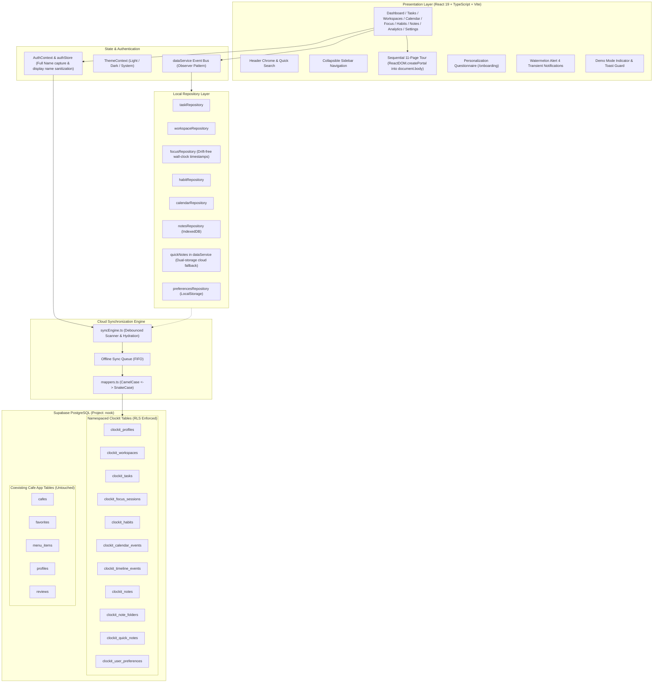

# ClockIt System Architecture

This document specifies the technical architecture of ClockIt, covering frontend layout, local repository layer, data synchronization engine, Supabase integration, and shared database coexistence.

---

## 1. High-Level Architectural Decomposition

ClockIt follows a **local-first reactive architecture**. The user interface reads and writes exclusively to local repository abstractions, providing instantaneous UI response times with zero perceived network latency. A background cloud synchronization engine observes repository writes, computes delta changes against cached snapshots, and idempotently reconciles rows with Supabase via Row-Level Security (RLS).

---

## 2. Diagram A: Overall System Architecture

---

## 3. Layer Breakdown

### A. Presentation Layer
- **Component Architecture**: Built with functional React components, strict TypeScript interfaces, and scoped CSS files.
- **Routing**: `react-router-dom` with `/` (landing), `/login`, `/signup`, `/onboarding` (first-time personalization), and protected `/app/*` routes wrapped in `ProtectedRoute`.
- **Transitions**: Smooth page routing transitions via `PageTransition` and branded `LoginTransition`.
- **Notifications**: Standardized transient notifications adhering to Watermelon Alert 4 specification (`NotificationToast.tsx`) with teal border, status icons, and theme compatibility.

### B. Reactive Data Layer
- **`dataService`**: Central event dispatcher using the Observer pattern. When any repository mutates data, `dataService.notify()` triggers listeners across active components.
- **Repositories**: Standardized CRUD interfaces (`taskRepository`, `workspaceRepository`, etc.) abstracting physical storage (`localStorage` vs IndexedDB).
- **Focus Timer**: High-precision wall-clock countdown engine with drift-free elapsed calculation (`performance.now()` delta), modes (Deep Work, Short Break, Long Break), custom settings, and fullscreen Zen mode. Music widget has been excised.
- **Quick Notes**: Instant thought capture via `QuickNotesCard` on the dashboard and `QuickNotesModal` for full-screen expanded drafting.

### C. Cloud Sync Layer
- **Local-First Diffing**: Takes in-memory snapshots of each table signature. When a mutation occurs, the diff engine identifies the changed entity and enqueues an upsert or delete.
- **Dual-Storage Fallback**: Quick notes and personalization fields are stored in their primary tables with a mirrored fallback in `clockit_user_preferences`, ensuring offline reliability.
- **Client ID Mapping**: Internal client IDs (`t-1`, `personal`) are preserved in the `client_id` column of the PostgreSQL table, while Supabase assigns unique `uuid` primary keys.
- **Conflict Free**: Every upsert uses `onConflict: 'user_id,client_id'` to guarantee idempotent re-runs.

### D. Multi-Tenant Database Boundary
- **Isolated Tables**: All 11 tables prefixed with `clockit_`.
- **RLS Boundary**: `auth.uid() = user_id` ensures that even with the anon key, no user can read, insert, update, or delete records belonging to another tenant or the coexisting café app.
